# Deep Learning + DOA: Wave Direction Estimation Based on Graph Signal Processing [with Python code]

Introduction In contemporary signal processing, the ability to accurately estimate the direction of arrival (DOA) of signals is crucial in various fields, including wireless communication, radar systems, sonar, and microphone arrays. DOA estimation is a fundamental component of tasks such as beamforming, target tracking, and spatial positioning. Traditionally, DOA estimation methods largely rely on classical signal processing techniques, such as beamforming algorithms and subspace methods, like Multi-Signal Classification (MUSIC), Root-Augmented MUSIC (RUMUSIC), and Eigenvector Transformation for Estimation of Signals in the Arbitrary Polar Configuration (ESPRIT).
In parallel to solving problems using classical methods, there has been an increasing interest in paradigms like Graphical Signal Processing (GSP), which effectively model and analyze data with complex structural dependencies. GSP extends traditional signal processing concepts to data represented by graphs or networks, where nodes represent data samples and edges capture their relationships or interactions. The framework provides a powerful toolkit for developing the underlying structure and topology of data, enabling more powerful and effective signal processing techniques.
Applying GSP to the problem of DOA estimation offers another innovative solution. By converting sensor measurements into nodes in a graph and using its edges to depict their spatial connections, GSP provides a systemic approach that leverages spatial correlation, thereby improving DOA estimation.
In this work, we explore the use of GSP technology for DOA estimation and test its effectiveness through comparison with classical methods. This paper reviews traditional DOA estimation methods and their limitations. Then, it proposes GPS-based algorithms suitable for DOA estimation, discusses their theoretical foundations and practical applications. Finally, performance comparisons and simulation analyses are presented between these methods and traditional approaches.
Through this work, our goal is to demonstrate the potential value of graphical signal processing as a valuable tool to enhance DOA estimation capabilities.
The Graph Signal Processing (GSP) provides a robust framework for analyzing signals defined on irregular or structured data domains, such as graphics. In GSP, signals are represented as nodes on the graph, and edges capture the relationships or interactions between these nodes. By leveraging the graph topology, GSP can develop robust signal processing algorithms to address challenges encountered in irregular sampling patterns, noise, and real-world data.
GSP extends classical signal processing concepts to graph structured data, allowing familiar tools like Fourier transforms, filtering, and spectral analysis to be applied to analyze signals on graphics. This framework allows exploration of the fundamental properties of graphic signals, including smoothness, bandwidth, and spectral representation.
Examples of GSP applications include urban mobility patterns and social network analysis. By modeling data as segmented smooth graphics signals, GSP captures large-scale changes between entities while preserving small-scale variations. Such representations help understand complex phenomena, such as urban flow patterns and behavioral trends in social networks.
Using GSP for DOA estimation involves converting sensor measurement values into nodes within the graph and using graph edges to depict their spatial connections. This allows for the exploitation of spatial dependencies in the data, as we believe and will examine, thereby improving DOA estimation results.
Graph-based DOA Estimation A. Related Work
Methods for solving DOA problems based on graphs utilize the spatial configuration of sensor arrays to construct graph representations, where each sensor node is connected to its neighbors based on physical proximity. The signals received by these sensors are then considered as graph signals, with edges capturing their spatial correlation.
Figure 1: DOA Estimation
Once the sensor is represented as a graph, we can compute the adjacency matrix A, where edges are established between any two elements in the radar array, resulting in a fully connected A with zeros along its diagonal. The spatial phase shifts in the radar array form the structure of A. The matrix A has similar properties to the covariance matrix, enabling graph Fourier transform (GFT) analysis. The GFT of the adjacency matrix yields a characteristic value decomposition, providing insights into signal analysis. The eigenvectors correspond to non-zero positions indicating the target's alignment. By measuring the orthogonality between the measurement steering vector and the noise subspace, we can determine the precise DOA.
To better understand the relationship between DOA and GSP, as well as how to use it to solve DOA problems, we searched for relevant research.
[1] In the scenario of multi-target and multi-angle, a DOA estimation method based on GSP is proposed. By utilizing the theory of GSP, a fully connected adjacency matrix based on radar array spatial phase shift is proposed. The multi-target azimuth DOA estimation is realized by using the GFT method. Comparative analysis shows that the performance of the GSP algorithm is close to that of the MUSIC algorithm, especially under low signal-to-noise ratio conditions.
[2] This method involves representing the spatial displacement of a sensor array using a graph framework, wherein the signal vector corresponds to the eigenvectors of the adjacent matrix. Unlike traditional methods, this approach avoids the need to arrange data in a circular buffer. Leveraging the concept of graph multiplication, it establishes the relationship between the time series of sensor-received signals and the uniform linear array (Uniform Linear Array, or ULA)'s fast-sampling characteristics. The proposed spatial-temporal graph structure enables the design of target functions for DoA estimation using graph Fourier transforms. We can understand the effectiveness of this method even in challenging environments characterized by multipathing and interference.
These studies highlight the potential of GSP in advancing DOA assessment techniques, providing innovative solutions, and addressing limitations of traditional methods. Based on the observed results, we have decided to attempt implementing an algorithm to solve the DOA problem using GSP itself.
Figure 2: Radar Array Signal Model
B. Based on Figure-Based Algorithms
We are concerned with fully connected graphs, as shown in Figure 2. For such a graph, the adjacency matrix will be:
Figure 3: Adjacency Matrix
In this case, we will obtain a maximum value λI, called the eigenvector αθi, along with the number of singular values belonging to the noise subspace M − 1. The projection of the input signal x(t) is obtained by averaging the received snapshots, which is essentially the GFT of the received input. In this case, the normalized GFT coefficients should approximately be δ[K−M], because it is the projection of x(t) onto As(θ).
For the case of x(t), when it is applied on As(θ2) and other angles are obtained, the spectral energy will be uniformly distributed:
Figure 4: GFT representation of the signal vector hitting the standard uniform linear array (UWB) at -20. When the GFT comes from an incorrect DOA, dispersion is uniform, and when the GFT corresponds to the correct DOA, it is unimodal.
For the case of two processes, where observations are obtained from two DOAs, x(t) is a linear combination of the two processes, so we do not get any pure δ in any case. For this reason, our algorithm may be effective when two sources are very close to each other. However, most of the signal energy will still concentrate in the highest index:
Figure 5: GFT representation of the signal vector hitting the standard direction in two directions. The difference between the correct or incorrect direction reflects.
When we seek DOA, we are looking for a function that depends on the direction and will achieve the maximum value in the correct direction. Typically, the purpose of pursuing the peak is to determine the most accurate DOA result. Therefore, identifying the peak by eliminating the reciprocal of the maximum feature value is achieved [1]:
QA is the As feature vector matrix. It can be imagined that adding M - D elements together, but we found this method inefficient, so we chose to add M - 1 elements. The concept of having repetitive roots in the eigenvalue matrix usually limits the function's result to a large extent:
Figure 6: Signal spectrum, using one source's FGSP (θ), noise-free condition
In this section, through simulation analysis, we verified the previous analysis and confirmed the effectiveness of using GSP to solve DOA problems. We have simulated the array described in the angle range [-100°, 100°] with two sources, assuming a minimum interval between sources of 20°. This allows for clear resolution.
For our simulations, we used the model provided in [2], including narrowband signals as the original signal input. As shown in Figure 7, considering 20 microphones, where the processing module after the A/D converter is an analysis bandpass filter centered at ω0, ω0 is the center frequency of the input narrowband signal. This module aims to eliminate the negative part of the input signal spectrum by effectively introducing a sample delay through multiplication with the complex exponential e^(iω0τ). In sm(t), represented by a single cosine, the signal from the mth microphone after passing through the bandpass filter can be expressed as s(k) = e^(iω0 k).
Since our signals are deterministic, we found that the subspace method described in III was unrelated to this model.
Figure 7: Sensor with M sensors
As shown in Figure 5, in a system with two sources, Δ x = QH Ax energy concentrates on the last index. Therefore, the spectrum is not as smooth as in a single scenario.
Figure 8: Signal spectrum, using two sources' FGSP (θ)
Even though the spectrum is not traditionally smooth, it is evident that we can still distinguish these peaks. This observation helps understand why the algorithm is not highly sensitive to SNR changes, as shown in Figure 9.
Figure 9: RMSE of GSP algorithm as a function of SNR
Conclusion In this project, we explore the use of Generalized Gaussian Process (GGP) to estimate the direction of arrival (DOA). We found it valuable for deterministic signals and showed good consistency under SNR modifications. Future research can be conducted to utilize graph properties to improve the algorithm, and extend the use of GSP in a more robust context compared to another known algorithm in the context of DOA estimation. It is also possible to examine its usage in low-resolution or hybrid-resolution data. 
References [1] Multi-target direction-of-arrival estimation method based on graph signal processing, CIE International Conference on Radar (Radar),2021. 
[2] A. S. Moreira, L. L. Ramos,L. R. de Campos, A. Apolinario Jr. , G.Serrenho, "A graph signal processing approach to direction of arrivalestimation," EUSIPCO, 2019.

## Images

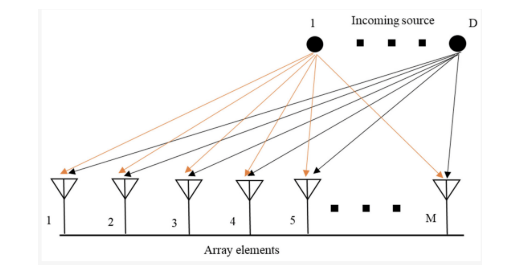
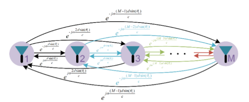
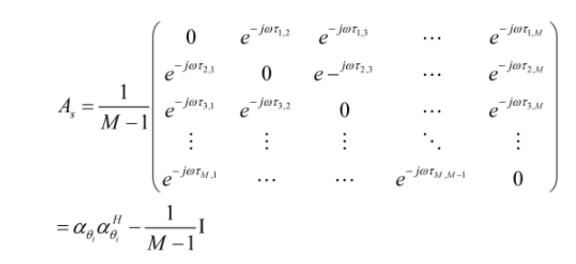
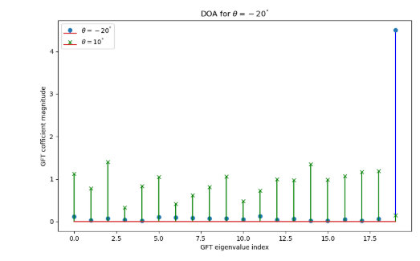
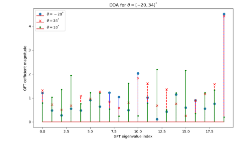
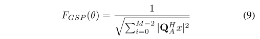
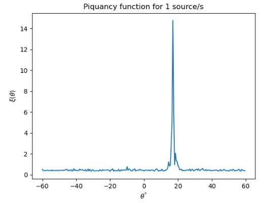
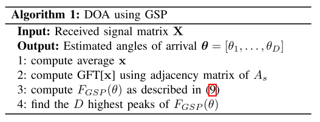
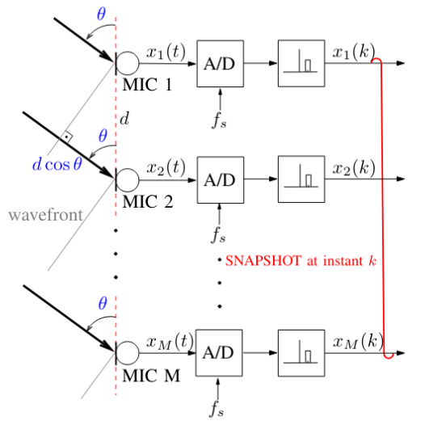
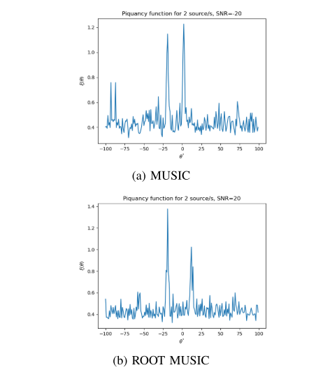
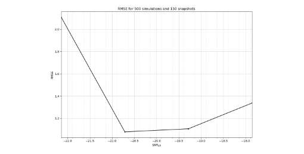
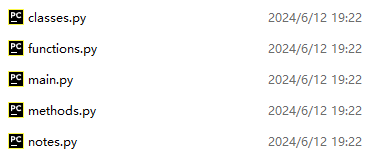

<!-- PAYMENT_BLOCK -->

## Get this dataset

- Payment link (Stripe): [Buy now](https://buy.stripe.com/3cs8yP7sY87d0vu9AB)
- Payment QR code: 

<!-- /PAYMENT_BLOCK -->
